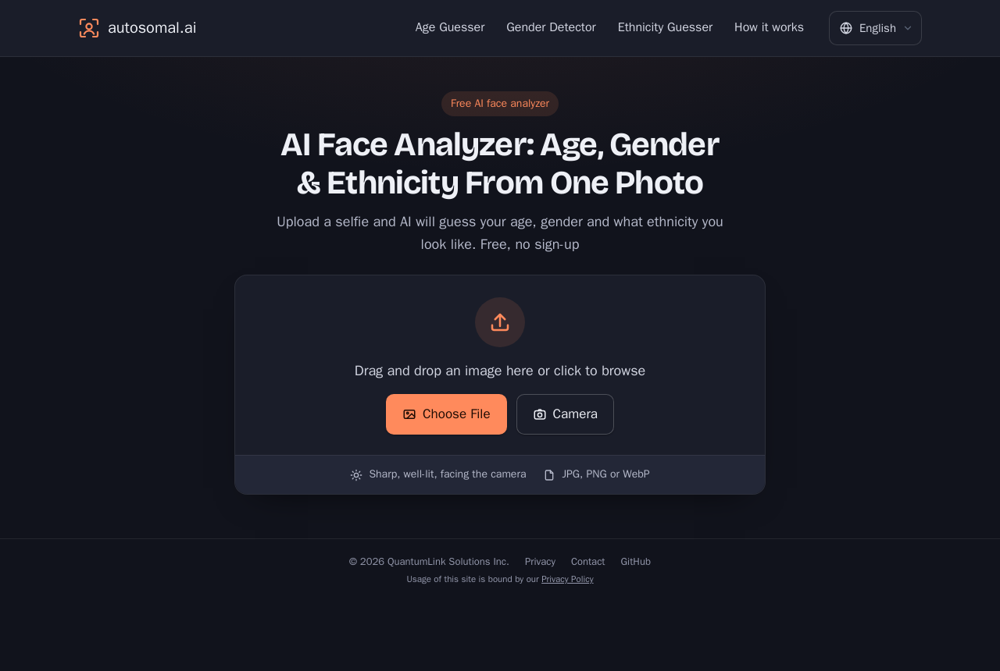
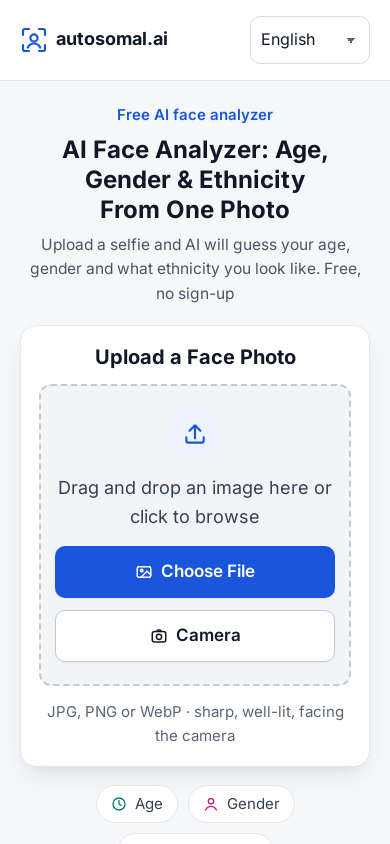

  

<h1 align="center">autosomal.ai</h1>

  <b>A free AI face analyzer: age, gender, and the world regions a face resembles.</b> 
  One photo, a few seconds, no sign-up. In 55 languages.

  
  
  

  
  &nbsp;
  

---

## What it does

Upload a selfie or use your camera, and autosomal.ai shows:

| Tool | What you get |
|---|---|
| **Age** | How old the face looks. Try the [age guesser](https://autosomal.ai/age-guesser). |
| **Gender** | Which gender the AI reads, with a confidence score. Try the [gender detector](https://autosomal.ai/gender-detector). |
| **You look like…** | Which of 16 world regions the face resembles most, with a percentage for each. Try the [ethnicity guesser](https://autosomal.ai/ethnicity-guesser). |

- Works on phones and desktops, in the browser, with no app to install
- Share your results with one tap
- Just for fun: a photo shows appearance, not ancestry

## Languages

[English](https://autosomal.ai/) · [العربية](https://autosomal.ai/ar/) · [Deutsch](https://autosomal.ai/de/) · [Español](https://autosomal.ai/es/) · [فارسی](https://autosomal.ai/fa/) · [دری](https://autosomal.ai/fa-af/) · [Suomi](https://autosomal.ai/fi/) · [Français](https://autosomal.ai/fr/) · [Magyar](https://autosomal.ai/hu/) · [Bahasa Indonesia](https://autosomal.ai/id/) · [日本語](https://autosomal.ai/ja/) · [Nederlands](https://autosomal.ai/nl/) · [Português](https://autosomal.ai/pt/) · [Română](https://autosomal.ai/ro/) · [Русский](https://autosomal.ai/ru/) · [Svenska](https://autosomal.ai/sv/) · [Türkçe](https://autosomal.ai/tr/) · [한국어](https://autosomal.ai/ko/) · [中文（简体）](https://autosomal.ai/zh/) · [中文（繁體）](https://autosomal.ai/zh-tw/) · [Tiếng Việt](https://autosomal.ai/vi/) · [ไทย](https://autosomal.ai/th/) · [Filipino](https://autosomal.ai/tl/) · [हिन्दी](https://autosomal.ai/hi/) · [اردو](https://autosomal.ai/ur/) · [አማርኛ](https://autosomal.ai/am/) · [Soomaali](https://autosomal.ai/so/) · [Bahasa Melayu](https://autosomal.ai/ms/) · [မြန်မာ](https://autosomal.ai/my/) · [ខ្មែរ](https://autosomal.ai/km/) · [ລາວ](https://autosomal.ai/lo/) · [Italiano](https://autosomal.ai/it/) · [Polski](https://autosomal.ai/pl/) · [Українська](https://autosomal.ai/uk/) · [Ελληνικά](https://autosomal.ai/el/) · [Čeština](https://autosomal.ai/cs/) · [עברית](https://autosomal.ai/he/) · [Azərbaycanca](https://autosomal.ai/az/) · [Kurdî (Kurmancî)](https://autosomal.ai/ku/) · [کوردی (سۆرانی)](https://autosomal.ai/ckb/) · [پښتو](https://autosomal.ai/ps/) · [Հայերեն](https://autosomal.ai/hy/) · [ქართული](https://autosomal.ai/ka/) · [Oʻzbekcha](https://autosomal.ai/uz/) · [Қазақша](https://autosomal.ai/kk/) · [বাংলা](https://autosomal.ai/bn/) · [ਪੰਜਾਬੀ](https://autosomal.ai/pa/) · [தமிழ்](https://autosomal.ai/ta/) · [తెలుగు](https://autosomal.ai/te/) · [मराठी](https://autosomal.ai/mr/) · [ગુજરાતી](https://autosomal.ai/gu/) · [नेपाली](https://autosomal.ai/ne/) · [Монгол](https://autosomal.ai/mn/) · [Kiswahili](https://autosomal.ai/sw/) · [Hausa](https://autosomal.ai/ha/)

## FAQ

**Is it free?** Yes, with no account or app.

**Does it work on phones?** Yes. Use your camera or pick a photo from your gallery.

**How accurate is it?** The results are estimates. A sharp, front-facing photo works best; filters, sunglasses and dim light make them less reliable. The "you look like" result describes resemblance, not ancestry, and it's often wrong.

**Is the code open source?** No. This repository is the project's page on GitHub.

**How do I get in touch?** Use the contact form on [autosomal.ai](https://autosomal.ai).

## About

autosomal.ai is a product of QuantumLink Solutions Inc.
